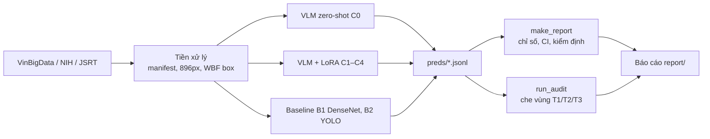
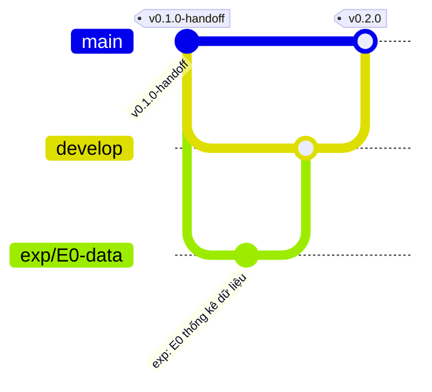

# Trợ lý AI phát hiện và định vị nốt phổi trên X-quang ngực

**Tinh chỉnh LoRA mô hình ngôn ngữ–thị giác cỡ nhỏ** — đồ án cuối kỳ CS315.G12.LT.TTNT (Máy học nâng cao), UIT – ĐHQG-HCM.

*An AI Assistant for Lung Nodule Detection and Localization on Chest X-rays via LoRA-Tuned Small Vision-Language Models.*

> **Bạn mới nhận bàn giao?** Đọc theo thứ tự:
> 1. [`docs/handoff/README.md`](docs/handoff/README.md), bản tóm tắt; bản đầy đủ là [`so_tay_ban_giao.pdf`](docs/handoff/so_tay_ban_giao.pdf).
> 2. [`report/main.pdf`](report/main.pdf), báo cáo. Đây là tài liệu phải bám theo khi chạy thực nghiệm.
> 3. [`code/RUNBOOK.md`](code/RUNBOOK.md), các lệnh chạy thực nghiệm E0–E5 trên Colab.
> 4. [`docs/design/`](docs/design/), spec đã duyệt. Khi có mâu thuẫn, spec là chuẩn.

## Ý tưởng trong 30 giây

Mô hình ngôn ngữ–thị giác (VLM) mở cỡ nhỏ như MedGemma-4B và Qwen2.5-VL-3B nhận ảnh X-quang và câu hỏi "Có nốt phổi không? Nếu có, ở đâu?", rồi trả lời bằng JSON. Khi chưa tinh chỉnh (zero-shot), chúng gần như luôn trả lời "bình thường". Đồ án tinh chỉnh chúng bằng LoRA trên VinBigData, rồi so với baseline CNN là DenseNet-121 (B1) và YOLOv8 (B2). Đánh giá gồm cả tập ngoài (NIH, JSRT) và một phép kiểm toán che vùng để xem mô hình có "nhìn đúng chỗ" không.

Tiêu chí thành công: **sensitivity ≥ 0,60 tại specificity 0,90**.



## Cấu trúc repo

| Thư mục | Nội dung |
|---|---|
| `code/` | Gói Python `nodulecxr`, các `scripts/`, 75 test CPU, `RUNBOOK.md` |
| `report/` | Báo cáo LaTeX (`main.tex` → `main.pdf`); ô `[--]` màu đỏ chờ kết quả |
| `docs/handoff/` | Sổ tay bàn giao (PDF và Markdown) |
| `docs/design/` | Spec đã duyệt (v2, 2026-11-12, §8.5 ghi chú triển khai) |
| `docs/decisions.md` | Nhật ký quyết định |
| `docs/lit-review/` | Ghi chú tổng quan 90 bài; PDF bài báo **không** có trong git vì bản quyền |
| `docs/archive/` | Kế hoạch triển khai cũ, chỉ để tham khảo lịch sử |
| `data/` | Dữ liệu ảnh, **không** commit (xem `data/README.md`) |

## Trạng thái lúc bàn giao (2026-11-13)

- [x] Pipeline đã cài đặt xong; `cd code && pytest -q` chạy 75 test và tất cả đều đạt.
- [ ] Phần GPU mới kiểm tra ở mức biên dịch. Phiên Colab đầu tiên **phải** chạy 7 mục "Kiểm tra bắt buộc" trong RUNBOOK.
- [ ] Chưa tải dữ liệu, chưa chạy thí nghiệm nào (E0–E5).
- [ ] Báo cáo còn các ô kết quả `[--]`.

## Bắt đầu nhanh (CPU, máy cá nhân)

```bash
git clone https://github.com/minhdang900/uit-cs315-lung-nodule-cxr-vlm.git
cd uit-cs315-lung-nodule-cxr-vlm/code
python -m venv ~/.venvs/nodulecxr && source ~/.venvs/nodulecxr/bin/activate
pip install -e ".[dev]"
pytest -q
```

Chạy GPU (MedGemma cần L4 hoặc A100, không dùng T4): xem `code/RUNBOOK.md`.

## Quy trình Git

`main` là bản ổn định, có tag. `develop` là nhánh tích hợp. Mọi việc làm trên `feature/*`, `exp/*` hoặc `docs/*`, rồi mở PR vào `develop`. Khi phát hành thì mở PR từ `develop` vào `main` và gắn tag. Chi tiết ở sổ tay bàn giao, chương 6.



**Không bao giờ commit:** dữ liệu ảnh, trọng số mô hình, `outputs/`, HF token, PDF sách hoặc bài báo, danh sách sinh viên.
