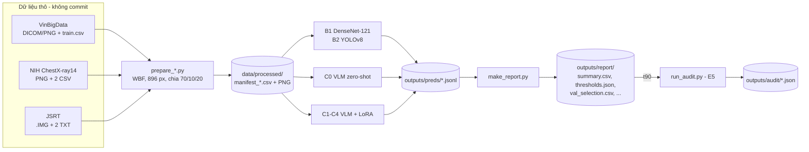
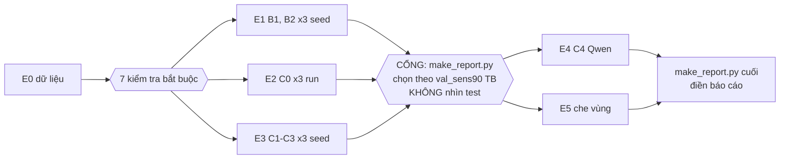
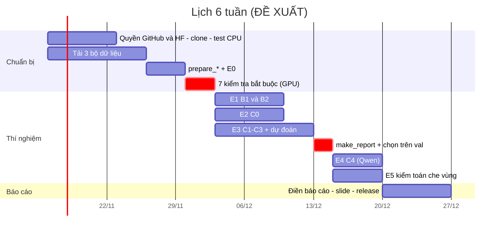
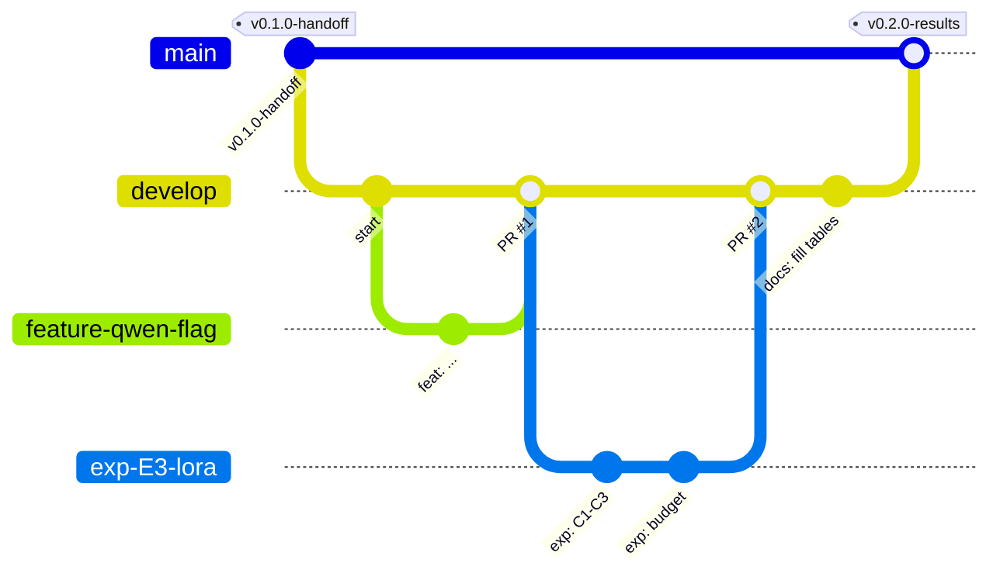

# Sổ tay bàn giao (bản rút gọn)

Đồ án CS315 Máy học nâng cao (UIT-VNU): **Trợ lý AI phát hiện và định vị nốt phổi trên X-quang ngực: tinh chỉnh LoRA mô hình ngôn ngữ–thị giác cỡ nhỏ.**

Đây là bản Markdown rút gọn, để đọc trên GitHub. Bản đầy đủ, có giải thích kiến thức nền và hình minh họa: **[so_tay_ban_giao.pdf](so_tay_ban_giao.pdf)**.

| Tài liệu | Vai trò |
|---|---|
| [Spec](../design/2026-11-12-lung-nodule-cxr-vlm-lora-design.md) | Văn bản có hiệu lực cao nhất. Đọc kỹ §8.5. |
| [RUNBOOK](../../code/RUNBOOK.md) | Nguồn duy nhất cho lệnh chạy. |
| [Báo cáo (PDF)](../../report/main.pdf) | Báo cáo học thuật; ô đỏ `[--]` chờ kết quả. |
| [Nhật ký quyết định](../decisions.md) | Vì sao mọi thứ đang như vậy (D1–D27). |
| [Sổ tay đầy đủ (PDF)](so_tay_ban_giao.pdf) | Kiến thức nền, runbook chi tiết, lỗi thường gặp, thuật ngữ. |

Thứ tự ưu tiên khi các tài liệu khác nhau: **spec > RUNBOOK > sổ tay**.

---

## 1. Trạng thái lúc bàn giao (2026-11-13)

- Pipeline đã viết xong. 75 kiểm thử CPU qua (`pytest -q` trong `code/`, cần có torch; thiếu torch thì vài test bị skip).
- Phần GPU (transformers, peft, ultralytics, torchxrayvision) **mới chỉ được kiểm tra cú pháp**. Phiên GPU đầu tiên **phải** chạy 7 mục "Kiểm tra bắt buộc trên Colab" trong RUNBOOK trước E1–E5.
- Chưa tải bộ dữ liệu nào. Chưa chạy thí nghiệm nào. Báo cáo còn ô đỏ `[--]` cho E0–E5.

## 2. Bắt đầu nhanh

1. Nhận lời mời vào repo private `minhdang900/uit-cs315-lung-nodule-cxr-vlm`.
2. Clone repo **một lần** vào `/content/drive/MyDrive` theo RUNBOOK §0 (bước "Lần đầu tiên"; repo private nên cần GitHub token hoặc `gh auth login`). Mỗi phiên đặt `REPO = "/content/drive/MyDrive/uit-cs315-lung-nodule-cxr-vlm"` rồi `%cd {REPO}/code`. Clone chỗ khác thì chỉ đổi `REPO`.
3. Trên máy cá nhân:
   ```bash
   cd code
   python3 -m venv .venv && source .venv/bin/activate
   pip install -e ".[dev]"          # them ",torchcpu" de chay du 75 test
   pytest -q
   ```
4. Xin quyền `google/medgemma-4b-it` trên Hugging Face (chấp nhận điều khoản Health AI Developer Foundations). Tạo token. Lưu vào **Colab Secrets** tên `HF_TOKEN`. Không dán token vào notebook hay commit.
5. Colab Pro với GPU **L4 hoặc A100**. **Không dùng T4** (MedGemma cần bf16 thật; code sẽ báo `RuntimeError`).
6. Đọc điều khoản và tải dữ liệu (xem mục 5). Dữ liệu chỉ dùng cho nghiên cứu, **không phân phối lại**.
7. Chạy E0 → 7 kiểm tra bắt buộc → E1–E3 → `make_report.py` → chọn cấu hình trên val → E4, E5 → điền báo cáo.
8. Điền tên GVHD ở trang bìa báo cáo (`[ĐIỀN TÊN GVHD]` trong `report/main.tex` và `report/chapters/00_front.tex`).

## 3. Kiến trúc



Mọi mô hình ghi cùng một định dạng JSONL (một dòng mỗi ảnh: `image_id, dataset, split, score, label_pred, boxes_pred, parse_ok, raw_text, config, seed, run`, và `model` với VLM). Nhờ vậy một script `make_report.py` chấm được tất cả.

**Cấu trúc repo**

```text
code/                 goi Python nodulecxr, scripts/, tests/, RUNBOOK.md
report/               bao cao LaTeX: main.tex -> main.pdf
docs/design/          spec
docs/handoff/         so tay nay (README.md + so_tay_ban_giao.pdf)
docs/lit-review/      ghi chu tong quan (PDF bai bao khong vao git)
docs/archive/         ke hoach trien khai cu, chi de tra lich su
docs/decisions.md     nhat ky quyet dinh
data/                 raw/ + processed/, gitignore (tru data/README.md)
outputs/              gitignore - ket qua chay (tao khi chay)
```

Lệnh RUNBOOK chạy từ `code/`: `M=../data/processed`, `D=/content/data` (ổ local Colab), `O=../outputs`.

## 4. Cấu hình và thí nghiệm

| Mã | Cấu hình | Lệnh chính |
|---|---|---|
| C0 | VLM zero-shot (MedGemma-4B, Qwen2.5-VL-3B) | `predict_vlm.py`, không `--adapter` |
| C1 | LoRA MedGemma, chỉ phân loại | `train_lora.py --mode cls` |
| C2 | LoRA MedGemma, phân loại + box | `train_lora.py --mode loc` |
| C3 | C2 + cân bằng lớp (w₊ = 2,0 cố định, không tinh chỉnh) | `train_lora.py --mode loc --balance --pos-weight 2.0` |
| C4 | Cấu hình tốt nhất C1–C3 trên Qwen2.5-VL-3B | `train_lora.py --model qwen` + cờ của cấu hình nguồn |
| B1 | DenseNet-121 | `train_densenet.py` |
| B2 | YOLOv8 | `train_yolo.py` |



**Lịch đề xuất** (đề xuất của người bàn giao, không phải lịch môn học; ngày bắt đầu chỉ để vẽ):



## 5. Dữ liệu (cờ lấy từ `argparse` của `code/scripts/prepare_*.py`)

| Bộ | Nguồn | Script và file cần có |
|---|---|---|
| VinBigData | Kaggle, cuộc thi `vinbigdata-chest-xray-abnormalities-detection` (phải chấp nhận luật) | `prepare_vinbig.py --train-csv train.csv --out-root $M` cùng **một** trong hai: `--dicom-dir` (file `<image_id>.dicom`) hoặc `--png-dir` + `--meta-csv` (PNG `<image_id>.png` và CSV có `image_id` + kích thước **gốc**, cột mặc định `dim0` = cao, `dim1` = rộng; đổi bằng `--h-col`/`--w-col`). Tùy chọn: `--official-test-csv` + `--official-test-dicom` (tập test VinDr-CXR; khi đó chia 85/15). |
| NIH ChestX-ray14 | NIH Clinical Center (hoặc bản Kaggle) | `prepare_nih.py --raw-dir <dir> --out-root $M`. Thư mục cần `Data_Entry_2017.csv`, `BBox_List_2017.csv` và **toàn bộ** ảnh PNG (ảnh âm rút ngẫu nhiên từ mọi ảnh "No Finding"). `--neg-ratio` mặc định 3. |
| JSRT | Japanese Society of Radiological Technology, cần đăng ký | `prepare_jsrt.py --raw-dir <dir> --out-root $M`. Cần `CLNDAT_EN.txt`, `NNDAT_EN.txt` (đúng tên, ngay trong `--raw-dir`) và các file `.IMG`. |

Dữ liệu thô để trong `data/raw/` (gợi ý `data/raw/vinbig/`, `nih/`, `jsrt/`), kết quả `prepare_*` vào `data/processed/` (xem `data/README.md`).

VinBigData chia theo `image_id` (70/10/20, phân tầng theo nhãn), **không** theo bệnh nhân (bản Kaggle không có mã bệnh nhân): rủi ro rò rỉ, phải nêu thành hạn chế (D9).

Chưa kiểm chứng: tên bộ PNG cụ thể trên Kaggle; định dạng file nhãn test VinDr-CXR; tên file thông tin trong gói tải JSRT hiện tại. Xem hộp "Chưa kiểm chứng được" trong sổ tay PDF §6.5.

## 6. Runbook

Mọi lệnh: [`code/RUNBOOK.md`](../../code/RUNBOOK.md). Sổ tay PDF §6 giải thích từng lệnh, kết quả mong đợi, cách kiểm tra và lỗi thường gặp. Tóm tắt:

- **§0 mỗi phiên Colab:** mount Drive, đặt `REPO`, `%cd {REPO}/code`, nạp `HF_TOKEN`, `pip install -q -e ".[gpu]"`, `rsync` ảnh sang `/content/data`. Mỗi ô lệnh là `%%bash` bắt đầu bằng `export M=../data/processed D=/content/data O=../outputs`.
- **7 kiểm tra bắt buộc:** tokenizer yes/no; `build_example`; loss pilot 160 mẫu (0,5–3, không phải 10–25); GPU capability ≥ 8; smoke YOLO; tốc độ mặt nạ phổi; tốc độ VLM. Mục nào hỏng thì dừng.
- **E0–E5:** chép nguyên lệnh trong RUNBOOK. `predict_vlm.py` tự chạy tiếp khi Colab ngắt; các script huấn luyện thì không.
- **Ngân sách:** lượt nào vượt 3 giờ thì cắt theo thứ tự: `--neg-per-pos 2` → (chỉ Qwen) giảm độ phân giải → `--epochs 2` → C1 chỉ 1 seed. Ghi vào `outputs/budget.md` và `docs/decisions.md`.

**Điền báo cáo:** `tab:main` ← `summary.csv` (`sens_mean`, `auc_roc_mean`); `tab:loc` ← `summary.csv` (`mean_best_iou_mean`, `hit_iou30_mean`, `hit_iou50_mean`, `jsrt_median_dist_mm_mean`); `tab:audit-res` ← `outputs/audit/*.json` (`flip_t1`, `flip_t2`, `delta`, `n_t2_ok`; cột T3 = 1 − `yes_rate_t3`); `tab:data-stats` ← `outputs/e0_data.md`. Bảng đầy đủ: sổ tay PDF §6.12.

## 7. Quy trình Git



- `main`: ổn định, có tag. `develop`: tích hợp. Làm việc trên `feature/<tên>` (code), `exp/<E#-tên>` (thí nghiệm), `docs/<tên>` (báo cáo, tài liệu).
- PR vào `develop` → ít nhất một bạn review → squash hoặc merge. Phát hành: PR `develop` → `main` + tag.
- Commit theo conventional commits: `feat:`, `fix:`, `docs:`, `exp:`, `chore:`.

```bash
git checkout develop && git pull origin develop
git checkout -b feature/<ten-ngan>
# ... sua code, chay pytest -q ...
git status                       # kiem tra: khong co data, outputs, trong so, token
git add <file cu the>
git commit -m "feat: <mo ta ngan>"
git push -u origin feature/<ten-ngan>
gh pr create --base develop
```

**Không bao giờ commit:** dữ liệu (`data/`, ảnh, DICOM, `.IMG`), trọng số (`*.pt`, `*.safetensors`, adapter), `outputs/`, token (HF, GitHub, `kaggle.json`), PDF có bản quyền, file danh sách nhóm `*.xlsx`. Lưu ý `.gitignore` không chặn `kaggle.json`, `*.dicom`, `*.IMG` nằm ngoài `data/`.

**Quyết định mới** ghi vào [`docs/decisions.md`](../decisions.md): mã D-số, ngày, quyết định, lý do, nguồn.

## 8. Quy tắc bắt buộc

- Chọn ngưỡng, epoch, cấu hình **chỉ trên validation**. Tập test chỉ dùng để chấm, một lần.
- Seed cố định 0, 1, 2; báo mean ± sd.
- Báo `unparsed` cạnh `raw_sens` cho mọi cấu hình VLM sinh văn bản.
- C0: bảng chính dùng run 0 (nhiệt độ 0).
- E5: báo `delta` kèm `n_t2_ok`.
- Không viết "ngang bác sĩ". Đây là nguyên mẫu nghiên cứu, không dùng lâm sàng.

## 9. Thuật ngữ chính

| Tiếng Việt | Tiếng Anh | Nghĩa ngắn |
|---|---|---|
| X-quang ngực | chest X-ray (CXR) | Ảnh xám 2D chụp lồng ngực. |
| Nốt / khối | nodule / mass | Tổn thương ≤ 3 cm / > 3 cm; gộp thành một lớp dương. |
| Độ mờ | subtlety | Mức khó thấy; JSRT chấm 1–5. |
| Mô hình ngôn ngữ–thị giác | vision-language model (VLM) | LLM có thêm bộ mã hóa ảnh. |
| Thích ứng hạng thấp | LoRA | Học thêm ma trận BA hạng nhỏ, giữ nguyên W. |
| Adapter | adapter | Trọng số LoRA đã học (thư mục `final/`). |
| Tinh chỉnh có giám sát | SFT | Huấn luyện bằng cặp câu hỏi–đáp án mẫu. |
| Che loss | loss masking | Không tính loss trên token câu hỏi. |
| Chế độ báo bình thường | normal-mode failure | Mô hình gần như luôn nói "không có nốt". |
| Độ nhạy / độ đặc hiệu | sensitivity / specificity | Tỷ lệ bắt đúng ca bệnh / bỏ qua đúng ca lành. |
| Ngưỡng t90 | threshold at spec 0.90 | Ngưỡng cho specificity 0,90 trên val. |
| Đường ROC, AUC | ROC curve, AUC | Sens theo 1 − spec; diện tích dưới đường. |
| IoU | Intersection over Union | Giao / hợp của hai box. |
| FROC | free-response ROC | Sens theo số box báo nhầm mỗi ảnh. |
| Hiệu chỉnh xác suất | calibration (ECE, Brier) | Điểm dự đoán khớp tỷ lệ đúng thật đến đâu. |
| Bootstrap CI | bootstrap confidence interval | Khoảng tin cậy từ lấy mẫu lại có hoàn lại. |
| McNemar / DeLong / Holm | – | So sens/spec bắt cặp / so AUC / hiệu chỉnh so nhiều cặp. |
| Phép che vùng | occlusion test (T1/T2/T3, Δ_occ) | Che nốt so với che chỗ khác cùng cỡ. |
| Rò rỉ dữ liệu | data leakage | Thông tin test lọt vào lúc huấn luyện/chọn. |
| Yêu cầu gộp | pull request (PR) | Đề nghị gộp nhánh, kèm review. |

Bảng đầy đủ (60+ thuật ngữ): sổ tay PDF, Phụ lục A.
